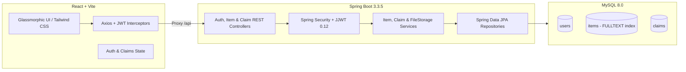

# On-Campus Lost & Found System

A modern, production-ready full-stack **On-Campus Lost & Found System** engineered with **Spring Boot 3.3.5 (Java 17+)**, **MySQL 8.0** with FULLTEXT indexing, **JWT Stateless Authentication**, and **React (Vite + Tailwind CSS + Lucide Icons)** featuring a glassmorphic UI.

---

## 🌟 Key Features

1. **Intelligent Keyword Search (MySQL FULLTEXT)**
   - High-performance keyword search querying `title`, `description`, and `location_found` simultaneously.
   - Combined with real-time category filtering (`ELECTRONICS`, `ACCESSORIES`, `IDS_CARDS`, `BOOKS`, `OTHER`) and status filtering (`UNCLAIMED`, `CLAIM_PENDING`, `CLAIMED`).

2. **Role-Based Access Control (RBAC)**
   - **Student**: Report found items with optional image uploads, browse feed, claim ownership of lost items, view personal reported items and track claim status.
   - **Campus Security / Admin**: Access the dedicated **Security Claims Portal** to evaluate ownership claims side-by-side against original reported items, approving or rejecting claims in one click.

3. **Ownership Claim Verification Workflow**
   - Confidential verification details (e.g. unique scratches, lockscreen wallpapers, serial numbers, pouch contents) submitted exclusively to Campus Security.
   - Dynamic status transitions: Submitting a claim shifts an item to `CLAIM_PENDING`. Approving a claim transitions the item to `CLAIMED` and automatically resolves conflicting pending claims.

4. **Modern Glassmorphic UI**
   - Sleek dark theme with backdrop blur, micro-animations, category badges, drag-and-drop file upload previews, and toast notifications.

---

## 🏛️ Architecture & Tech Stack



---

## 💾 Database Schema

The database `campus_lost_found` is configured with:

- `users`: `id`, `name`, `email` (UNIQUE), `password` (BCrypt), `role` (`STUDENT`, `SECURITY`, `ADMIN`), `created_at`.
- `items`: `id`, `title`, `description` (TEXT), `category`, `location_found`, `date_found`, `image_url`, `status` (`UNCLAIMED`, `CLAIM_PENDING`, `CLAIMED`), `reported_by` (FK -> `users.id`), `FULLTEXT INDEX ft_items_search (title, description, location_found)`.
- `claims`: `id`, `item_id` (FK -> `items.id`), `claimant_id` (FK -> `users.id`), `verification_details` (TEXT), `status` (`PENDING`, `APPROVED`, `REJECTED`), `created_at`.

DDL script is located at: `backend/src/main/resources/schema.sql`.

---

## 🚀 How to Run

### Prerequisites
- **Java 17+**
- **Apache Maven 3.8+**
- **MySQL 8.0+** (running on port `3306`)
- **Node.js 18+** & **npm**

### 1. Database Setup
Create database and verify MySQL connection (credentials in `backend/src/main/resources/application.properties`):
```sql
CREATE DATABASE IF NOT EXISTS campus_lost_found;
```

### 2. Backend (Spring Boot)
Navigate to the `backend` directory and run:
```bash
cd backend
mvn clean compile
mvn spring-boot:run
```
The backend server runs on `http://localhost:8080`.

### 3. Frontend (React + Vite)
In a separate terminal, navigate to the `frontend` directory:
```bash
cd frontend
npm install
npm run dev
```
The frontend will start at `http://localhost:5173`.

---

## 🔑 Demo Credentials

| Role | Email | Password | Permissions |
| :--- | :--- | :--- | :--- |
| **Student** | `student@campus.edu` | `password123` | Report items, submit claims, view personal status |
| **Student 2** | `sarah@campus.edu` | `password123` | Submit claims on other reported items |
| **Security Guard** | `security@campus.edu` | `password123` | Security Claims Portal, approve/reject claims |

*(You can also click "Quick Demo Fill" inside the sign-in modal for 1-click credential loading).*

---

## 📡 REST API Reference

### Authentication
- `POST /api/auth/register` — Register a student or security officer
- `POST /api/auth/login` — Sign in and receive JWT token

### Items Feed & Management
- `GET /api/items?query={keywords}&category={cat}&status={st}` — Fulltext search and filter items (Public)
- `GET /api/items/{id}` — Get single item details (Public)
- `GET /api/items/my` — Get items reported by current user (Authenticated)
- `POST /api/items` — Report item with multipart image upload (Authenticated)
- `DELETE /api/items/{id}` — Delete reported item (Reporter or Security/Admin)

### Ownership Claims
- `POST /api/claims` — Submit verification details to claim an item (Authenticated Student)
- `GET /api/claims/my` — Get claims submitted by the current user (Authenticated Student)
- `GET /api/claims` — Review all campus claims (Security / Admin)
- `PUT /api/claims/{id}/status` — Approve or Reject a claim (Security / Admin)

---

## ☁️ Deployment Guide

### 1. Backend on Render
1. Log in to [Render](https://render.com) and click **New +** -> **Web Service** (or use **Blueprint** with `render.yaml`).
2. Connect repository `pabbathivishnupranay-droid/Campus-Lost-Found`.
3. Choose **Docker** environment:
   - **Docker Context**: `./backend`
   - **Dockerfile Path**: `./backend/Dockerfile`
   - Alternatively (Native Java):
     - Root Directory: `backend`
     - Build Command: `./mvnw clean package -DskipTests`
     - Start Command: `java -Dserver.port=$PORT -jar target/campus-lost-found-1.0.0.jar`
4. Set Environment Variables:
   - `SPRING_DATASOURCE_URL`: `jdbc:mysql://<your-db-host>:3306/<database>?useSSL=false&allowPublicKeyRetrieval=true`
   - `SPRING_DATASOURCE_USERNAME`: `<db-user>`
   - `SPRING_DATASOURCE_PASSWORD`: `<db-password>`
   - `JWT_SECRET`: `9a2f8c4e7b1d6f3a8e5c2b9d0f1a4e7c3b6a9d2f5e8c1b4a7d0e3f6a9b2c5d8e` (or custom 64-char hex)
   - `APP_CORS_ALLOWED_ORIGINS`: `http://localhost:*,https://*.vercel.app`
5. Click **Deploy Web Service**. Render provides your API URL (e.g. `https://campus-lost-found-api.onrender.com`).

### 2. Frontend on Vercel
1. Log in to [Vercel](https://vercel.com) and click **Add New...** -> **Project**.
2. Import repository `pabbathivishnupranay-droid/Campus-Lost-Found`.
3. Configure Project Settings:
   - **Framework Preset**: Vite
   - **Root Directory**: `frontend`
   - **Build Command**: `npm run build`
   - **Output Directory**: `dist`
4. Environment Variables:
   - Add `VITE_API_URL` = `https://<your-render-service>.onrender.com`
5. Click **Deploy**. Your app is live with SSL!

